# Finnaux Test Log: Adam and Eve

Tracking file for the phased test run described in
`FINNAUX2.0-API/TEST_ARCHITECTURE.md`. Lives in `penguin/testing/` (moved from the API folder on 2026-11-25 at the human's request);
evidence in `test-evidence/` next to it, run data (sweep, probe plan/results, table counts) in `test-evidence/data/`. No passwords, no personal data (ids and counts only).

- Database: `finnaux_dev` (local Docker, `finnaux-api-postgres-1`, port 5432). Never switched.
- API: `https://localhost:4321` | UI: `http://localhost:3000`
- Accounts: `adam` (Adam (Test Admin), level 1), `eve` (Eve (Test), level 5; accounts rebuilt 2026-11-25 12:26 IST)

## Phase tracker

| Phase | Scope | Status | Started | Finished |
|---|---|---|---|---|
| P0 | Pre-flight: environment, accounts, baseline, outbound safety | done | 2026-11-25 | 2026-11-25 |
| P1 | T0 view-only, all modules (Eve), UI + API read checks | done (param-free GETs + key UI screens) | 2026-11-25 | 2026-11-25 |
| P2 | T0 negative: write probes against API as Eve (unguarded endpoints) | done; 1 row to undo (human decision) | 2026-11-25 | 2026-11-25 |
| P3 | T1-T4 per module (add, edit, delete, print/export), granted via Adam | done: Dashboard, Reports-U, Customer, LOS, LMS (partial: money flows blocked), Accounts T0-T3 done (one ₹1 pending journal voucher posted and deleted; never authorised, no outbound), Managed Portfolios T0 done (T1+ blocked: real loans), CRM done (tickets T1 blocked: workflow config), HRMS done (payroll processing blocked), Configuration done, Admin done | 2026-11-25 | 2026-11-25 |
| P4 | T5 process rights (LOS/LMS) | done (code check: process rights never enforced by the API; confirms FINDING 17) | 2026-11-25 | 2026-11-25 |
| P5 | T6 restricted admin pages (human present) + cross-cutting security (IDOR, session, leaks) | done: T6 negative and positive (granted via Adam, reverted), sessions, login, IDOR. FINDING 26-30, NOTE N10-N15 | 2026-11-25 | 2026-11-25 |

## Session journal

### 2026-11-25: P0 pre-flight

- `bash db status`: `.env points to: finnaux_dev (local)`. OK.
- `bash db test-users status`: adam 166/165/165/165, eve 150/0/0/0, both active. Footprint: none.
- API (`/swagger`) responds 200, UI responds 200.
- Backups (read-only check, nothing new written):
  - `finnaux_dev.dump` (2026-11-25 11:27) **contains** Eve's employee row: usable as the baseline.
  - `finnaux_dev_before_test_users.dump` (11:27) does **not** contain Eve, as expected.
- Outbound risk: `.env` has 7 non-empty `SMTP_*` / `SMS_*` values. Outbound sends are possible.
- Human decisions (2026-11-25):
  - Outbound: human says SMTP/SMS already cleared. Verified: all 7 `SMTP_*`/`SMS_*` values are empty
    (length 0). The `.env` was modified at 11:42:31, and the backend (`bun run start:dev`) restarted at 11:44:21.
    The DB still holds integration configs (SMS configs, API credentials), so rule 2 (no outbound actions) still applies.
  - Baseline: use the existing `finnaux_dev.dump` (11:27). No new backup is taken.
  - T0 write probes: empty or invalid bodies only. No real records are created.
  - UI testing: built-in browser + API (curl).
- P1 start: the first API login attempt (eve, then adam) got HTTP 000, connection refused on :4321.
  - `/swagger` had answered 200 a few minutes earlier.
  - `scripts/dev-watch.mjs` (pid 79058) is still alive, but its child `node dist/apps/finnaux-api/main.js` has exited,
    and nothing listens on :4321. dev-watch does not restart the server after a crash.
  - Cause unknown: the crash output is in the human's terminal. Possible NOTE / FINDING if the login request
    itself crashed the server. **Paused: asked the human to restart the backend and share the crash output.**

### 2026-11-25: P0 re-check (new agent session, after accounts rebuilt)

- `bash db status`: `finnaux_dev (local)`. Branch `feat/external-apis`.
- `bash db test-users status`: adam level 1, 166/165/165/165; eve level 5, 150/0/0/0; both active; footprint none.
- Accounts created 2026-11-25 06:56 UTC (12:26 IST). Baseline `finnaux_dev.dump` is 12:27 IST, so it holds the
  rebuilt accounts. Usable as the baseline. **No new backup taken.**
- Backend running again: `main.js` pid 86687 started 11:50:42, listening on :4321. `/swagger` 200, UI 200.
- `.env` outbound: all 7 `SMTP_*`/`SMS_*` are set to a black hole (`127.0.0.1` port 9). `.env` mtime 11:50:40,
  backend restarted 2 s later, so the backend runs with the black-holed values.
  DB-stored integration configs are untouched, so rule 2 still applies in full.
- Log file: `TEST_LOG.md` is untracked and **not** ignored (`git check-ignore` finds no rule).
- Human decisions (this session):
  - Log: keep everything in the API folder (`FINNAUX2.0-API/TEST_LOG.md`); overwriting the old log is allowed.
  - Outbound: rule 2 only (never press outbound actions; mark BLOCKED: outbound). No DB change.
  - P1 approved: read-only checks as eve and adam (API + built-in browser).

### 2026-11-25: P1 started (T0 view-only, API)

- API login: adam 201, eve 201. Response has no password field. Session cookie `finnaux_session` is HttpOnly + Secure.
  Unknown-user login answers 404 (see note N1). Security headers present (HSTS, nosniff, X-Frame-Options SAMEORIGIN).
  Rate limit 100 requests per window.
- OpenAPI: 835 paths (504 GET, 305 POST, 166 PUT, 57 DELETE, 5 PATCH).
- Static guard count (handler level): ~~GET 161/342 ...~~ **corrected in P2**: GET 143 guarded / 360 not; POST 69 / 235; PUT 68 / 98; DELETE 20 / 37; PATCH 5 / 0 (370 of 532 writes unguarded). The first count wrongly treated a controller as guarded when it only imported the decorator.
- GET sweep: every parameter-free GET as eve and as adam (status + size). Skipped as outbound risk:
  `/integrations/kvb/*`, `/ckyc/providers/status`, `/reports/ucrf-report/{generate,download/*}`, `/dnbs02/export`,
  `/fintech/*`, `/lms/customer/identity-lookup`, `/lms/customer/digio-customer-draft`, `/customer-app/*`.
- GET sweep done: 270 tested, 19 skipped. eve: 217x200, 28x400, 19x500, 5x403, 1x404. adam: 221x200, 1x403.
- UI login as eve (headless Chrome, throwaway profile): OK, lands on `/`. Screenshots in `test-evidence/screenshots/`.
- Static candidates for P2 (unguarded writes on restricted areas; **not probed yet**):
  `PUT /configuration/external-apis/integration-groups/:id`, `PUT /configuration/message-configuration/sms-configuration/:id`,
  `POST /hrms/employees/off-role` (no body, no guard), `GET /hrms/employees/filter`.

### 2026-11-25: P1 evidence and panel

- Human asked for screenshots and responses in the log, and the findings in the penguin panel.
- Evidence written to `test-evidence/` (12 redacted response files, 12 API evidence cards, 6 UI screenshots).
  Redaction check: 0 unmasked values in all response samples. UI shots blur table cells, inputs and labels
  (one shot was retaken because a filter label showed an employee name).
- Penguin panel: entry `howismycommit-59` in `penguin/.penguin/data/backend/howismycommit.json`, added with
  `node scripts/penguin.mjs add howismycommit --repo backend`. 9 findings (3 high, 3 medium, 3 low), all `open`.
  The panel labels it "Uncommitted changes" because it has no label for a test run.
- Next: P2 (T0 write probes with empty bodies) waits for the human's approval.

### 2026-11-25: P2 write probes (T0, Eve)

- Human approved P2 ("Yes, start P2").
- Method: global `ValidationPipe` has `whitelist` but not `forbidNonWhitelisted`, so `{}` passes for all-optional DTOs
  and would run the handler. Therefore only handlers whose body DTO has a required field were probed live
  (body `{}`, path ids replaced by the non-existent `01ZZZZZZZZZZZZZZZZZZZZZZZZ`). 532 write handlers:
  267 probed, 148 excluded (outbound, auth, sessions, payroll process, convert-to-employee, letters, OAuth, gateway, enquiry),
  117 not called (no body / all-optional / untyped body: they would execute) and reported from code.
- Row-count snapshot of all 369 tables before and after (read-only).
- Results: 106 x 403 (guard works), **145 x 400** (passed the guard, validation stopped it), **8 x 404** and **1 x 200**
  (handler ran against the fake id), **7 x 500** (handler ran without validation).
- **Side effect (my probe): 1 row written.** `POST /hrms/performance-management/goals` with `{}` enrolled Eve
  (`01ZTESTEVEEMP0000000000000`) into the existing review cycle `01M0A3QR5MVV0HWGXXX9YRESZS`
  (`performance_review_cycle_employee`, created 07:26:55 UTC, creator Eve). Root cause FINDING 9. A scan of every table's
  createdAt/updatedAt since 07:15 UTC shows no other created or updated row (besides Eve's new session). **Not undone yet:
  asked the human how to undo it.**
- **Rule-2 slip (my filter):** `POST /external/finnaux/aadhaar/generate-otp` was not caught by my outbound filter
  (it matched `/otp` but not `generate-otp`) and received `{}`. Validation refused the missing Aadhaar number (400),
  so no provider call was made and nothing was sent. Filter to be widened before any later probe. This also exposed FINDING 10.
- Evidence: `responses/P2-all-write-probes.json` (all 267 results), cards `screenshots/P2-*.png`.

### 2026-11-25: Undo decision, move, P3 start

- Human: leave the review-cycle row (`performance_review_cycle_employee`, Eve in cycle `01M0A3QR5MVV0HWGXXX9YRESZS`) in place;
  it goes away with the next baseline restore. It shows in `bash db test-users status` as Eve's footprint until then.
- Human: move the log, counts and all test data out of the API folder. Now in `penguin/testing/` (not git-ignored).
  `FINNAUX2.0-API` has only `TEST_ARCHITECTURE.md` untracked. Penguin entries 59 and 60 point at the new paths.
- Human: move to P3.


| # | Segment | Page (id) | Tier | Layer | Action | Expected | Actual | Result | Evidence |
|---|---|---|---|---|---|---|---|---|---|

### 2026-11-25: Log repair note

The P3 sections below were lost when the "move" entry above replaced the `## Results (Appendix B format)` heading without
re-adding it; every later append matched nothing and silently did not write. Rebuilt on 2026-11-25 from the session record
(same commands, results and ids). Penguin entries howismycommit-61..65 were not affected.

### 2026-11-25: P3 segments 1-2 (Dashboard, Reports-U)

- Server side: no controller checks `canPrint` or `canExport`. Report-page export runs in the browser from table data
  (`reports-user/_shared/visible-file-actions.tsx`); `GET /dnbs02/export` requires only `canView`.
- T0 (Eve view-only), UI, 9 pages: `test-evidence/responses/P3-T0-ui-actions.json`.
- Grant (Adam, Eve role): print + export on all 9 pages of Dashboard and Reports-U (read back OK). Eve totals after:
  150 view, 0 add/edit/delete, 9 print, 9 export.
- T4 (Eve), UI: identical buttons to T0 on every page. Negative: Accounts → Vouchers still shows no export.

| # | Segment | Page | Tier | Layer | Action | Expected | Actual | Result |
|---|---|---|---|---|---|---|---|---|
| 1 | Dashboard | Dashboard Collections / Sales | T0 | UI | Open | Opens, no print/export | Opens, no actions | PASS |
| 2 | Reports-U | Collection Efficiency | T0 | UI | Look for export | Hidden | **Export enabled** | FAIL (UI) |
| 3 | Reports-U | Master Data | T0 | UI | Look for export | Hidden | **Export enabled** | FAIL (UI) |
| 4 | Reports-U | DNBS02 | T0 | UI/API | Generate, export | Export hidden | Generate (GET) shown; export API needs only canView | FINDING 12 |
| 5 | Reports-U | Due List | T0 | UI | Open | Page opens | **404 page**: no UI route `/reports-user/due-list` | FAIL (UI) |
| 6 | Reports-U | Report Builder | T0 | UI | Save/Export | Hidden or disabled | Disabled | PASS |
| 7 | Reports-U | My Reports, UCRF Submission | T0 | UI | Open | Opens | Opens, no actions | PASS |
| 8 | both | all 9 pages | T4 | UI | Print/export after grant | Controls appear | **No change** from T0 | FAIL (UI) |
| 9 | Accounts | Vouchers | T4 neg | UI | Export | Hidden | Hidden | PASS |

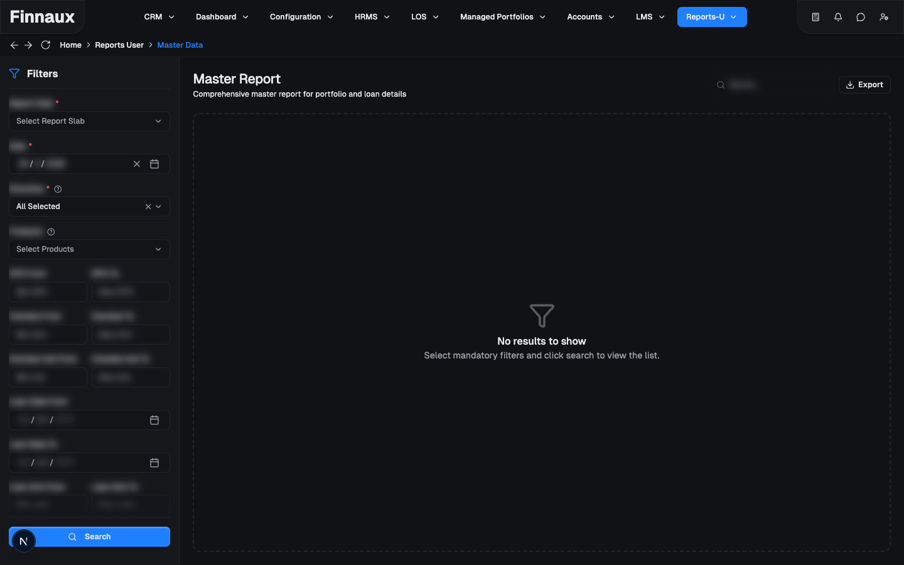
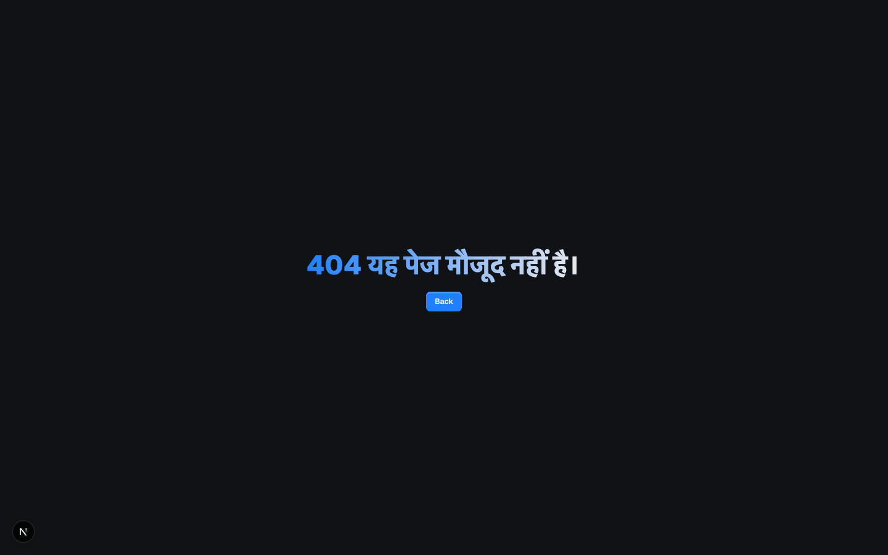

### FINDING 12: Print and export rights are not enforced (medium)

```
Where:     No controller checks canPrint/canExport. GET /dnbs02/export needs only canView. Report pages export client-side.
           UI: Collection Efficiency and Master Data show Export without the right; granting print/export changes nothing.
```

### FINDING 13: Reports-U "Due List" menu page has no UI route (low)

```
Where:     master_menu_pages "Due List" (slug due-list) -> http://localhost:3000/reports-user/due-list renders the 404 page
```

### 2026-11-25: P3 Report Builder T1-T3 (human approved ZZ-TEST data)

| # | Tier | Action (Eve unless noted) | Expected | Actual | Result |
|---|---|---|---|---|---|
| 10 | T0 | POST /reports/builder/templates, valid ZZ-TEST body | 403 | 403 | PASS |
| 11 | T1 | same, after canAdd | 201 | 201, id `01M88V1TFWDPPB5294PTNK2089` | PASS |
| 12 | T1 neg | PATCH / DELETE that template | 403 | 403 / 403 | PASS |
| 13 | T1 neg | POST /configuration/templates `{}` (neighbour page) | 403 | 403 | PASS |
| 14 | T1 | empty columns / unknown field id | 400 | 400 / 400 | PASS |
| 15 | T1 | second template with the same name | refused or by design | 201 (duplicates allowed) | NOTE |
| 16 | T2 | PATCH rename | 200 | 200 | PASS |
| 17 | T2 | PATCH empty columns | 400 | 400 | PASS |
| 18 | T2 neg | DELETE | 403 | 403 | PASS |
| 19 | T2 | **PATCH a template created by Adam (level 1)** | refused | **200, renamed** | FINDING 14 |
| 20 | T3 | DELETE own templates and Adam's | 200 | 200 x 3; repeat 404; list empty | PASS (Adam's: FINDING 14) |
| 21 | T3 | DB check | soft delete | 3 rows in `customReports`, `isActive=false` | PASS |
| 22 | T3 | UI Save/Export | enabled with rights | disabled (need columns first) | NOTE: inconclusive |

### FINDING 14: Report templates have no ownership or hierarchy check (medium)

```
Where:     PATCH/DELETE /reports/builder/templates/:id (report-builder.repository.ts filters by id only)
Actual:    Eve (level 5) renamed and deleted ZZ-TEST-ADAM-OWN created by Adam (level 1)
```

### 2026-11-25: P3 Customer T1-T2

Customer create/edit are guarded by LMS-module pages `CUSTOMER_INDIVIDUAL` (`01JWZZRYDD434Y3WSFPFBZWSGP`, canAdd) and
`CUSTOMER_DEMOGRAPHIC` (`01JWZZRYDEZZ1YECCPXP0EK1HQ`, canEdit). Create makes no provider call; no customer delete endpoint.

| # | Tier | Action (Eve) | Expected | Actual | Result |
|---|---|---|---|---|---|
| 23 | T0 | POST /lms/customer/individual `{}` | 403 | 403 | PASS |
| 24 | T1 | same after canAdd | 400 with required fields | 400, 16 messages | PASS |
| 25 | T1 | create ZZ-TEST customer (no phone, no email) | 201 | 201, `01M88V6VC0X2H0JGX02QHFY95X` | PASS |
| 26 | T1 | with 0 KYC documents and 0 contacts | refused if mandatory | accepted | NOTE N4 |
| 27 | T1 | `communication: [{}]` | 400 | not validated | NOTE N4 |
| 28 | T1 neg | PUT basic detail (no edit) | 403 | 403 | PASS |
| 29 | T1 neg | POST non-individual | 403 | 403 | PASS |
| 30 | T2 | PUT basic detail | 200 | 200; DB updated, updater Eve | PASS |
| 31 | T2 | invalid body | 400 | 400 | PASS |
| 32 | T2 | **PUT on a non-existent customer id** | 404 | **200 OK** | FINDING 15 |
| 33 | T3 | delete customer | n/a | no endpoint | NOTE |

### FINDING 15: Customer edit has no existence check and no branch scope (medium)

```
Where:     PUT /lms/customer/:customerId/individual/basic-detail (customer.service.ts filters by customerId only)
Actual:    200 OK for a non-existent id; any holder of CUSTOMER_DEMOGRAPHIC edit can change any customer (not exercised on real ones)
```

### 2026-11-25: P3 LOS

LOS pages (Eve view on all 5). Loan create: no page right; business rule = caller in the branch/product/amount range's
Application Generation list. Sequence increment runs in the request transaction.

| # | Tier | Action (Eve) | Expected | Actual | Result |
|---|---|---|---|---|---|
| 34 | T0 | POST /los/loan-application, ZZ-TEST body | 403 | 403 business rule | PASS (no page guard) |
| 35 | T0 | + `dangerouslySkipRightCheck: true` | stripped | 403 | PASS |
| 36 | T0 | sequence side effect of refused create | none | rolled back | PASS |
| 37 | T0 | PUT /los/update-swap-loan-application, fake ids | 403 | **400**: guard passed | FINDING 16 |

Human approved adding Eve to a branch range. Branch `01KX5PNW6V59T7CGAC41H03HCX`, product `01KYM59PM61JN530EGCKWME5FS`,
range `01M6NABWHGCMPQBRBX92HVTNYR` (0-500000): Eve added to Application Generation only, read back, **reverted** after the
tests and verified identical to the original; Eve refused again afterwards. The range PUT is a full replace (rows of existing
employees re-created with new ids and Adam as creator, twice). No LOS page right was granted.

| # | Tier | Action (Eve) | Expected | Actual | Result |
|---|---|---|---|---|---|
| 38 | T1 | create with an id from `/dropdown/area-details` | 201 | 409 FK on sourceAreaId (my input: dropdown gives location ids); nothing written | NOTE |
| 39 | T1 | create with a valid `areas` id | 201 | 201, loan `01M88VK1NEY3WBWVF44SBA1967`, PENDING | FINDING 17 (no page right) |
| 40 | T2 | PUT :id/user-loan-detail | needs edit right | 200; DB updated by Eve | FINDING 17 |
| 42 | T3 | POST :id/reject + injected `applicationStatus: "APPROVED"` | stripped | 201; REJECTED | PASS |
| 43 | T3 | reject again | 4xx | 201 OK, no change | NOTE N6 |
| 45 | after | create after removal from range | 403 | 403 | PASS |

### FINDING 16: Any logged-in user can reassign loan applications between employees (high)

```
Where:     PUT /los/update-swap-loan-application (los.controller.ts:46), no page right, no caller check (los.service.ts:655)
```

### FINDING 17: Loan application lifecycle has no page rights; LOS process rights are UI-only (high)

```
Where:     loan-application.controller.ts has 0 @RequirePageRight (create, user-loan-detail, reject, initiate-npa, authorise-npa ...).
           designationLmsProcessPageRights is read only by the designation admin and the UI session endpoint.
Actual:    view-only Eve created, edited and rejected a loan application.
```

### 2026-11-25: P3 LMS

Money flows need a disbursed loan: **BLOCKED** (real loans may not be touched). Guard state from P2 (fake ids): receipt
create, receipt collect, receipt authorisation and PUT /lms/collection passed the guard for view-only Eve (400). NACH
post/clear/bounce/undo/import have no page right (code); a `{}` probe was **blocked by the Claude Code permission classifier**
and not retried.

Grants (Adam, module LMS): Customer Address `01JWZZRYDEA1K2K5G2YPQYGGXP` V -> V A -> V A E; Customer Demographic
`01JWZZRYDEZZ1YECCPXP0EK1HQ` V E -> V A E.

| # | Tier | Action (Eve) | Expected | Actual | Result |
|---|---|---|---|---|---|
| 46 | T0 | POST address / bank on ZZ customer | 403 | 403 / 403 | PASS |
| 47 | T1 | POST address after canAdd | 201 | 201 | PASS |
| 48 | T1 neg | POST bank | 403 | 403 | PASS |
| 49 | T1 neg | PUT address (no edit) | 403 | 403 | PASS |
| 50 | T2 | PUT address after canEdit | 200 | 200, DB updated | PASS |
| 51 | T2 | same address under another customer id | refused | 400 | PASS |
| 52 | T1 | contact type `ZZ_NOT_A_TYPE` | 400 | 400 (DB enum) | PASS |
| 53 | T1 | EMAIL `not-an-email ZZ-TEST` | 400 | **201** | FINDING 18 |
| 54 | T1/T2 | valid `.invalid` email; PUT to fix | 201 / 200 | 201 / 200 | PASS |
| 55 | code | bank create calls Surepass? | no | not called | PASS |

### FINDING 18: Contact details are not format-validated (low)

### FINDING 19: Receipt creation, collection and authorisation have no page rights: maker-checker bypass (high)

```
Where:     POST /lms/:loanApplicationId/receipts, .../collect, POST /lms/receipt-authorisations/:receiptId, PUT /lms/collection;
           NACH post/clear/bounce/undo/import (code)
```

### 2026-11-25: P3 Accounts (T0, T1 without posting)

Every Accounts write handler declares a page right (11 of 11). Voucher create/edit/delete accept the flag on any of 12
voucher pages; the voucher service then checks the voucher-type right (`VoucherTypesService`: canCreate/canUpdate/canDelete
and day limits). Maker-checker: authorisation excludes vouchers created by the caller.

Grant (Adam): Voucher Accounts Journal `01JWZZRYDER4EHKNXTQS7PMZM3` (module Accounts) V -> V A.

| # | Tier | Action (Eve) | Expected | Actual | Result |
|---|---|---|---|---|---|
| 56 | T0 | POST /accounts/vouchers `{}` | 403 | 403 | PASS |
| 57 | T0 | PUT /accounts/voucher-decisions/update-status `{}` | 403 | 403 | PASS |
| 58 | T0 | POST /account/account-head `{}` | 403 | 403 | PASS |
| 59 | T1 | POST /accounts/vouchers `{}` after Journal canAdd | 400 | 400, 7 required fields; nothing posted | PASS |
| 60 | T1 neg | PUT /accounts/vouchers/:id (no edit) | 403 | 403 | PASS |

Correction: a "FINDING 20" (voucher-type rights unused) was drafted and withdrawn the same day: the voucher service does
enforce them; my first grep looked for the table, not the service.

Accounts T1-T3 with a posted voucher: **SKIPPED (human condition "only if it doesn't make any money-related changes")**.
Creating even a pending voucher takes a number from the strict voucher sequence (vouchers.service.ts create) and commits it;
a later delete leaves a permanent gap in voucher numbering, and not every money query was proven to exclude PENDING vouchers.
So no voucher was posted. Accounts is closed at T0-T1 (guard checks only).

### 2026-11-25: Penguin card titles (human request)

- Cards without a commit all showed "Uncommitted changes". Added an optional `target.title` to the panel
  (`src/app/penguin/_lib/types.ts`, `_lib/penguin.server.ts` normaliser, `_components/review-tab.tsx` label) and titled 10 cards:
  backend 59-65 ("Test run P1/P2/P3 · ..."), backend 50 and 29, frontend 91 ("Review · ..."). Verified in the panel: no card
  shows "Uncommitted changes". `npx tsc --noEmit` shows 2 errors in `api/git/branches/route.ts`, a file this change does not touch.
- Log repair: see "Log repair note" above.

### 2026-11-25: P3 Accounts T1-T3 (one ₹1 ZZ-TEST journal voucher)

Human approval: post only if no real money moves and no charges. Checked first: the voucher service depends only on internal
services (employees, voucher types, account heads, sequences, branch, company config, preferences); no payment, bank, SMS,
webhook or queue client; no database triggers on `vouchers` / `voucherDetails`. A voucher created through the API stays PENDING
(`shouldAlsoAuthorise` is never set by the controller) and was never authorised.

Grants (Adam): voucher type **Accounts (Journal (Self))** `01JX50D4KFBW20EYKNC01ZCYT7`: create/read/update/delete, 1 day each
(upsert of that one type; tree diff shows only it changed). Page Voucher Accounts Journal: V A -> V A E -> V A E D.

| # | Tier | Action (Eve) | Expected | Actual | Result |
|---|---|---|---|---|---|
| 61 | T1 | POST journal voucher, Round Off Dr ₹1 / Administrative Charges Cr ₹1, Eve's branch | 201 | 201, `01M88WGTSCP90Y5GWD7GZRZVAJ`, PENDING, not authorised | PASS |
| 62 | T1 neg | POST Payment voucher (no type right; Journal page right passes the page guard) | refused | 400 "You do not have the right to create this voucher under this designation" (first try 404: payment needs a cash/bank head) | PASS |
| 63 | T1 neg | PUT the voucher (no edit) | 403 | 403 | PASS |
| 64 | T2 | PUT narration after canEdit | 200 | 200 | PASS |
| 65 | T2 neg | DELETE (no delete) | 403 | 403 | PASS |
| 66 | T3 | DELETE after canDelete | 200 | 200; repeat 404; DB: isActive false, 0 active lines, still PENDING | PASS |

Result: Accounts behaves correctly on all three layers (page right, voucher-type right, maker-checker). No new finding.
ZZ-TEST data left: voucher `01M88WGTSCP90Y5GWD7GZRZVAJ` (inactive, never authorised).

### 2026-11-25: P3 Managed Portfolios

Page: Manage Lenders Loan `01KSQ694HKRSW5WF957FS0EE47`. All 7 co-lending writes declare the right flag: portfolio generate
(MANAGE_LENDERS_LOAN add+edit), create-dv-voucher (MANAGE_LENDERS_LOAN edit); lender create/update, DV deductions, closures
(CONFIGURATION_CO_LENDING add/edit/delete). Portfolio writes allocate real LMS loans to lenders and create DV vouchers, so live
T1-T3 is **BLOCKED: real loans/vouchers**. Lender create belongs to the Configuration segment (next).

| # | Tier | Action (Eve) | Expected | Actual | Result |
|---|---|---|---|---|---|
| 67 | T0 | POST /configuration/co-lending/portfolio/generate `{}` | 403 | 403 | PASS |
| 68 | T0 | POST .../portfolio/{fake id}/create-dv-voucher | 403 | 403 | PASS |
| 69 | T0 | POST /configuration/co-lending `{}` | 403 | 403 | PASS |

### 2026-11-25: P3 CRM

Pages: CRM `01KQC298R5YGPS0JPVVMVF6PTV` (Eve view), CRM Customer Request All `01KW1CYNPYNAJ40XK55VFEABJ2` (Eve none). Ticket
notifications are in-app only (DB row + realtime push to clients of this local server) and skipped when the assignee is the
caller; a ticket's assignee defaults to the caller. CRM configuration writes are all guarded (Configuration pages).

Grant (Adam): CRM Customer Request All: none -> V A.

| # | Tier | Action (Eve) | Expected | Actual | Result |
|---|---|---|---|---|---|
| 70 | T0 | POST /crm/entry NOTE on ZZ loan/customer | 403 | **201**, entry `01M88WP68N6X1YHGQHB1XR17NY` | FINDING 20 |
| 71 | T0 | POST /crm/entry with a fake loan id | 4xx | 409 FK (generic message) | PASS |
| 72 | T0 | PUT /crm/entry/:id/status PENDING, then COMPLETED + reassign to Adam (level 1) | 403 | **200 / 200**; DB: COMPLETED, RM = Adam, updater Eve | FINDING 20 |
| 73 | T0 | status on a fake id | 404 | 404 | PASS |
| 74 | T0 | POST /crm/tickets, POST .../forward, POST ticket-type, GET tickets/dashboard | 403 | 403 x 4 | PASS |
| 75 | T1 | POST /crm/tickets valid ZZ body after V A | 201 | 400 "Ticket process must be an entry step (Level 1) in the CRM workflow" | BLOCKED: needs CRM workflow config |
| 76 | T1 | POST /crm/tickets `{applicationId, unexpectedField}` | 400 | **500** (body not validated: `import type` DTOs, FINDING 9); nothing written (scan of all tables) | FINDING 9 confirmed |

### FINDING 20: CRM entries can be created, closed and reassigned by any logged-in user (medium)

```
Where:     POST /crm/entry and PUT /crm/entry/:id/status (crm/crm.controller.ts) declare no page right
Actual:    view-only Eve created an entry on a loan, set it COMPLETED and reassigned it to a level-1 user
Notes:     @IsEnum(CRM_*_VALUES) passes an array, so error messages list no values ("must be one of the following values: ");
           table crm_entries has snake_case columns (loan_application_id, attachment_url, ...) against the AGENTS.md rule
```

ZZ-TEST data left: CRM entry `01M88WP68N6X1YHGQHB1XR17NY`.

### 2026-11-25: P3 HRMS

Code: only `designation` (7) and `employee` (8 of 9) write handlers declare page rights. **None** of the writes in attendance (7),
leave (18), payroll (11), performance (31), recruitment (21), holidays (4) or tours (2) do; 57 of them already passed the guard
for view-only Eve in P2. Recruitment, leave and attendance services touch only the database (no mail/SMS). No grant was needed
or made for this segment. Payroll processing and bank export: **BLOCKED** (money).

| # | Tier | Action (Eve, view-only) | Expected | Actual | Result |
|---|---|---|---|---|---|
| 77 | T0 | POST /hrms/leave-management/apply, 1 day 2026-11-30 | allowed (own leave) | 201, request `01M88WVHAC4FG01EY5KPB8AZPR`, PENDING | PASS |
| 78 | T0 | **PUT requests/:id/status APPROVED on her own request** | refused (approver = requester) | **200**; DB APPROVED by Eve; Nov usedDays 0 -> 1 | FINDING 22 |
| 79 | T0 | POST /hrms/attendance/mark-attendance for Adam (level 1) | 403 | 400 "Cannot mark attendance without an assigned shift": guard passed | FINDING 21 |
| 80 | T0 | POST /hrms/recruitment-management/jobs (ZZ-TEST, Eve's branch/HR dept/role) | 403 | **201**, job `01M88WWA795471ZM4G0M91AJ9Z` | FINDING 21 |
| 81 | T0 | PUT job with salaryRangeMin 5 > salaryRangeMax 1 | 400 | **200** | NOTE N8 |
| 82 | T0 | PUT jobs/:id/status CLOSED (no delete endpoint) | 403 | 200 | FINDING 21 |

### FINDING 21: HRMS writes have no page rights outside employee/designation (high)

```
Where:     hrms attendance, leave, payroll, performance, recruitment, holiday, tour controllers: 0 @RequirePageRight on 94 writes
Actual:    view-only Eve created, edited and closed a job opening and reached the attendance logic for another (level 1) employee;
           P2: 57 writes passed the guard (incl. salary assignments, payroll loans/adjustments, holidays)
Severity:  high
```

### FINDING 22: HR members can approve their own leave (high)

```
Where:     hrms/leave-management/leave-management.service.ts updateLeaveStatus (~line 374): checks HR department and
           approver.level <= requester.level, never approver != requester
Actual:    Eve (in "Human Resource (HR)", level 5) applied and then gave final APPROVED to her own request; balance deducted
Severity:  high (maker-checker on leave defeated; same pattern likely for extra-work and cancellations)
```

NOTE N8: job salary range accepts min > max.

ZZ-TEST data left: leave request `01M88WVHAC4FG01EY5KPB8AZPR` (APPROVED, Eve's own balance), job `01M88WWA795471ZM4G0M91AJ9Z` (CLOSED).

### 2026-11-25: P3 Configuration

Code: most configuration masters are guarded (asset, branch-area, co-lending, CRM config, dealer, insurance, legal, menu,
parking yards, questions, reports, templates, vendors). Unguarded writes: **all 36 import-data endpoints**, the 5 company
settings PUTs, SMS config, external-apis integration groups, MCLR (2), loan-product notification templates (2), branch
assignments and deviation assignments (5).

| # | Tier | Action (Eve) | Expected | Actual | Result |
|---|---|---|---|---|---|
| 83 | T0 | POST /configuration/import-data/employees/validate, non-existent file | 403 | 404 "File ... not found": guard passed (read-only dry run, nothing written) | FINDING 23 |
| 84 | T0 | GET then PUT /configuration/company-security-settings with the **same** values | 403 | **200**; all flags identical afterwards | FINDING 24 |
| 85 | T0 | POST /configuration/parking-yards `{}` | 403 | 403 | PASS |
| 86 | T1 | create ZZ-TEST yard after canAdd | 201 | 200 "OK" (no id returned; id from DB `01M88X1A9CMMAXPMQZ63S3A8TM`) | PASS |
| 87 | T1 neg | PUT / DELETE (no edit/delete) | 403 | 403 / 403 | PASS |
| 88 | T2 | PUT after canEdit; DELETE still refused | 200 / 403 | 200 / 403 | PASS |
| 89 | T3 | DELETE after canDelete; repeat | 200 / 404 | 200 / **200** (no-op OK, like N6); DB isActive false | PASS |

(First attempt at 86-89 used the empty id from the create response and got 404s; rights were reset to add-only and redone.)

### FINDING 23: Bulk import endpoints have no page rights; employee import creates logins with a hardcoded password (critical)

```
Where:     configurations/import-data/import-data.controller.ts: 36 POST .../{type}/validate|import, no @RequirePageRight
           import-employees.service.ts:40 DEFAULT_IMPORT_PASSWORD is a string literal; every imported employee gets its hash
Actual:    view-only Eve reached employees/validate (404 only because the file did not exist). By code, the same user can import
           employees with any DesignationName (including Admin) and log in with the known default password; also salary,
           attendance, vouchers, loans, customers. Not executed (would create accounts).
Severity:  critical (privilege escalation to admin; secret in source)
```

### FINDING 24: Company security settings writable by any logged-in user (critical)

```
Where:     PUT /configuration/company-security-settings (configurations.controller.ts), no page right
Actual:    view-only Eve's PUT returned 200 (values re-sent unchanged, verified identical). The same call can switch off OTP
           validation, MAC address validation, voucher maker-checker and KYC/communication masking for the whole company.
Severity:  critical (extends FINDING 8)
```

ZZ-TEST data left: parking yard `01M88X1A9CMMAXPMQZ63S3A8TM` (inactive). Company security settings row: values unchanged,
updater now Eve.

### 2026-11-25: P3 Admin (Rule Engine), human present

Page: Rule Engine `01KJC6N94AARA7FG4D5TZY54KS` (Eve view). Only the 2 rule-engine GETs are guarded; POST /rule, POST /ruleset,
**PUT /ruleset/:id**, POST /workflow, PUT /workflow/:id have no page right. Rule expressions are evaluated with expr-eval 2.0.2
(`Parser.evaluate(ruleExpression, body)`, process-orchestrator.ts:1551, default options). Tables rule / master_rule / workflow
have no audit columns (no creator, updater or timestamps). Existing rulesets/workflows were not touched. No grant was made.

| # | Tier | Action (Eve, view-only) | Expected | Actual | Result |
|---|---|---|---|---|---|
| 90 | T0 | POST /workflow `{"name":"ZZ-TEST P3 workflow"}` | 403 | **200 OK**, workflow `01M88X54CPB1K4TV4VRQ00BBQ5` | FINDING 25 |
| 91 | T0 | PUT /workflow/:id without rulesetIds | 400 | 400 (not retried: would attach rulesets) | n/a |
| 92 | T0 | POST /rule without outputConfig | 400 | **500** (DTO optional, DB NOT NULL); nothing written | NOTE N9 |
| 93 | T0 | POST /rule, expression `1 == 1`, zero scores | 403 | **201**, rule `01M890RYJ2GR4J3B20KVJDGQAC` | FINDING 25 |

### FINDING 25: Credit rules, rulesets and workflows can be created and changed by any user; expressions run on expr-eval 2.0.2 (high)

```
Where:     rule-engine/rule-engine.controller.ts (POST rule, POST/PUT ruleset), workflow/workflow.controller.ts: no page rights
Actual:    view-only Eve created a workflow and a credit rule. PUT /ruleset/:id would let the same user change live loan decisioning.
Risk:      rule expressions are evaluated by expr-eval 2.0.2, which public advisories list as affected by code-execution issues
           (CVE-2025-12735, CVE-2026-12866; sources disagree on a fixed release). Not exploited or tested.
Audit:     rule / workflow tables keep no creator/updater/timestamps.
Severity:  high
```

NOTE N9: POST /rule without outputConfig returns 500 (optional in DTO, NOT NULL in DB).

ZZ-TEST data left: workflow `01M88X54CPB1K4TV4VRQ00BBQ5`, rule `01M890RYJ2GR4J3B20KVJDGQAC` (no soft delete exists for either).

### 2026-11-25: P4 process rights (T5), code check

No grant made. Every reader of `designationLmsProcessPageRights` (designation.service, sessions/lms-process-pages, loan-application process-page-rights GETs, process-orchestrator) only returns the flags to the UI. No LOS or LMS service checks `canAdd`/`canEdit`/`canDelete` from them. The only server-side LOS checks are: branch employee range for Application Generation (loan-application.service.ts:405-438) and the TAT assignee check on income/expense delete. Runtime proof is already in P3 LOS (rows under FINDING 17: Eve worked process steps while holding view-only process rights). A before/after grant would only change the UI, so it was skipped. **Result: FINDING 17 confirmed; T5 adds nothing on the API.**

### 2026-11-25: P5 restricted pages (T6 negative only), sessions, IDOR

T6 positive tests (granting Eve any of the 16 restricted pages) were **not done**: they need the human at the screen and touch people/rights screens. Only negative checks and empty-body probes ran. Table counts for deviation and operation assignments and employee tours: `0|190|50|1` before and after (no change). Evidence: `test-evidence/data/P5-*.txt`.

| # | Tier | Action (Eve) | Expected | Actual | Result |
|---|---|---|---|---|---|
| 94 | T0 | GET employees list, employee branch/product/los-process/department, designation list, audit-logs, employee-assign-range | 403 | 403 (8/8) | pass |
| 95 | T0 | Designation editors (page, menu, voucher-type, report, process rights) | guarded | all 15 routes carry DESIGNATION_* rights; Eve cannot raise her own role | pass (code + 403 on GET) |
| 96 | T0 | GET /configuration/branch/:otherBranch/product/:p/deviation-assignments | 403 | **200** | FINDING 26 |
| 97 | T0 | POST and PUT deviation-assignments, body `{}` | 403 | **400** (validation; guard passed). Nothing written | FINDING 26 |
| 98 | T0 | POST/PUT /configuration/branch/:b/assignments, body `{}` | 403 | **400** (guard passed). Nothing written | NOTE N10 |
| 99 | T0 | GET employees/:root/employee-hierarchy, /hrms/employee-tours | 403 | **200**: 29 employees (id, name, manager); all tours (name, dates, purpose) | NOTE N11 |
| 100 | none | POST /auth/login: unknown user vs real user, wrong password | same reply | **404 vs 401**, different text, ~7 ms vs ~80 ms | FINDING 27 |
| 101 | none | 10 wrong-password logins | lockout or slow-down | none; only the global 100 req/min per-IP throttler | NOTE N12 |
| 102 | T0 | GET /los/loan-application/:otherBranchLoan/customer, activity-logs, tat | 403/404 | **200**: 3 customers (51 fields incl. date of birth, caste, religion, signature, photo URL), 90 activity rows, 16 TAT rows | FINDING 28 |
| 103 | T0 | GET /sessions | own only | own 8 sessions only; DELETE /sessions/:id is scoped to own employee | pass |
| 104 | T0 | DELETE /auth/logout, then replay the old cookie | 401 | 401; DB session `isActive=false`, reason LOGOUT | pass (Eve API session ended; 7 older Eve sessions still active, limit is 10) |

### FINDING 26: Deviation approvers for any branch can be replaced by any logged-in user (high)
`configuration/branch/:branchId/product/:productId/deviation-assignments` GET, POST and PUT have no `@RequirePageRight` (configurations/branch/branch.controller.ts:196, 219), while the neighbouring employee-assign-range routes require BRANCH_PROCESS_EMPLOYEE. The deviation services (fee, policy, manual and document deviations) read these tables to decide who may approve a loan deviation. PUT is worse: `updateDeviationAssignments` (branch.service.ts:761) ignores the URL branch and product, **hard-deletes** every deviation type for the `rangeId` in the body and inserts the caller's list. **Impact:** a branch user can make themselves approver of their own loan deviations (maker-checker bypass) or wipe approvers for any branch. **Fix:** add BRANCH_PROCESS_EMPLOYEE edit rights to POST/PUT and view to GET; check that `rangeId` belongs to the URL branch and product; soft-delete instead of hard delete. Evidence: rows 96-97 (400 on `{}` proves the guard was passed; nothing written).

### FINDING 27: Login reveals which usernames exist (medium)
`LoginDto.username` has `@UserExists()` (auth/validators/user-exists.validator.ts:30), which throws **404 "Username or password incorrect"** for an unknown or inactive user before the password is checked. A real user with a wrong password gets **401 "Username or password is incorrect"**. bcrypt is skipped for unknown users, so the reply is also ~10x faster. **Impact:** with no account lockout (N12), staff usernames can be listed, then targeted for password guessing. **Fix:** remove `@UserExists()` from LoginDto; return the same 401 and text for both cases and compare against a dummy hash when the user is missing. Evidence: `test-evidence/data/P5-login-enumeration.txt`.

### FINDING 28: Loan application detail routes have no branch check (IDOR) (high)
Eve (one branch) opened a loan application of another branch by id: `/customer` returned 3 customers with 51 fields each (names, date of birth, caste, religion, signature, photo URL), `/activity-logs` 90 rows and `/tat` 16 rows. Her own branch's loan answered the same way, so nothing separates the two. This is the per-record form of FINDING 2 (lists unscoped). Loan ids are ULIDs (time-ordered), so they can be guessed near known ids. **Fix:** in a shared loan-application access check, require that the loan's branch is one of the caller's branches (`employeeBranches`) before any `:loanApplicationId` route runs. Evidence: rows 102, `test-evidence/data/P5-idor-customer-field-names.txt` (field names only).

NOTE N10: Branch operation assignments (waiver and write-off limits) POST/PUT/DELETE have no page right; today only their own service reads the tables, so the impact is limited until a waiver flow uses them.
NOTE N11: `/hrms/employees/:id/employee-hierarchy` and `/hrms/employee-tours` have no page right: the whole org chart (29 names) and every employee's tour dates and purpose are readable. Same pattern as FINDING 6.
NOTE N12: No account lockout or per-account login limit. Only the global throttler (100 requests per minute per IP) applies, enough for about 144,000 guesses a day per IP.
NOTE N13: AuthGuard checks the session row but not `employees.isActive`; no API route deactivates an employee, so a DB-side deactivation leaves live sessions working for up to 7 days (cookie maxAge 604800000, sameSite none).
NOTE N14: POST /hrms/employees/off-role has no page right but is a stub that returns OK and writes nothing.

### 2026-11-25: P5 T6 positive (restricted pages granted via Adam, human present)

The human logged Eve in again (password typed in their terminal, never seen). Snapshot first: Eve role 151 active page-rights rows, level 5, all limits 0. Only the "Eve (Test)" role was changed; no employee or other role was written.

| # | Tier | Action | Expected | Actual | Result |
|---|---|---|---|---|---|
| 105 | T6 | Adam grants view on all 16 restricted pages in one PUT, using a module none of them belong to | refused or limited to module | 200; 16 rows written (151 to 167) | NOTE N15 |
| 106 | T6 view | Eve GETs employees (29), root's branch/product/process/department, 54 roles, Admin role detail and its rights, audit logs (50), company details | 200 | 200 on all | pass (expected with grant) |
| 107 | T6 view | Eve GETs External APIs credentials for 15 API groups | secrets masked | **21 plain-text values** (API key, API secret, encryption key) for 9 services: Aadhaar, Bank Account, Credit Bureau, Driving License, Face Match, PAN, Udyam OTP, Vehicle RC, eSign. Not printed or stored | FINDING 30 |
| 108 | T6 | Eve (DESIGNATION_PAGE view only) PUTs her own role page-rights | 403 | 403 | pass |
| 109 | T6 edit | Adam grants DESIGNATION_PAGE edit; Eve gives her own role EMPLOYEE_MAIN edit | refused (own role / right she lacks) | **200**, EMPLOYEE_MAIN canEdit false to true | FINDING 29 |
| 110 | T6 | Eve (DESIGNATION_MAIN none) PUTs her own role level 5 to 1 | 403 | 403 | pass |
| 111 | T6 edit | Adam grants DESIGNATION_MAIN edit; Eve sets her own role level 1 | refused | **200**, level 1 (Admin level). Adam restored it; role equals snapshot | FINDING 29 |
| 112 | cleanup | Adam sets all 16 restricted pages to all-false | back to baseline | 151 original rows unchanged; 16 extra rows all-false (the API cannot delete a rights row); Eve 403 again on employees, roles, audit logs | pass |

### FINDING 29: Role rights, role settings and employee edits have no hierarchy check: self-escalation to Admin (critical)
`DesignationService.updatePageRights` and `update` (hrms/designation/designation.service.ts:449, 74) write any role, including the caller's own role and the Admin role, with no level or ownership check, and grant rights the caller does not hold. `updateOnRoleEmployee` (hrms/employee/employee.service.ts:311) changes any employee's username, password and role with no level check; `hasHigherDesignation` exists but only one LOS step uses it. **Proven on Eve's role:** with DESIGNATION_PAGE edit she gave herself EMPLOYEE_MAIN edit; with DESIGNATION_MAIN edit she set her role to level 1. Employee edit was checked in code only (a live test would change a real login). **Impact:** any HR or branch user given one of these pages can make themselves Admin, raise their own waiver and payment limits, or reset the Admin password. Combined with FINDING 23 (open employee import) this is a full takeover path. **Fix:** in all three services, refuse writes to the caller's own role and to roles or employees at the same or a higher level (`hasHigherDesignation(session, target, allowEqual=false)`); refuse granting a right the caller does not hold; log every rights change.

### FINDING 30: External API credentials are returned in plain text to anyone with view on External APIs (high)
GET `/configuration/external-apis/api-groups/:id/credentials` needs only EXTERNAL_APIS canView and returns stored secrets unmasked: 21 values across 9 services (field names FINNAUX_API_KEY, FINNAUX_API_SECRET, FINNAUX_ENCRYPTION_KEY, apiKey). This database is a copy of production, so these may be live keys. **Impact:** anyone with the page (or a stolen session of such a user) can call KYC, eSign, credit bureau and bank verification services as the company, at its cost, and decrypt data protected by the encryption key. **Fix:** never return secret values; return only "set / not set" and the last 4 characters; keep PUT for replacing them; consider rotating keys that were ever exposed. Evidence: `test-evidence/data/P5-T6-external-api-credentials-summary.txt` (counts and field names only).

NOTE N15: The page-rights PUT ignores the moduleId in the URL: any page id in the body is granted, even pages of another module or of no module.

## Grants made by Adam (P3)

| # | Page (id) | Flags before | Flags after | Reason |
|---|---|---|---|---|
| 1 | Dashboard Sales, Dashboard Collections | V | V P X | T4 Dashboard |
| 2 | 7 Reports-U pages (Report Builder, My Reports, Due List, Collection Efficiency, Master Data, Ucrf Submission, Dnbs 02) | V | V P X | T4 Reports-U |
| 3-5 | Report Builder (01M6DRP86KKFEJSZZVRYBJA8X5) | V P X | V A E D P X (stepwise) | T1-T3 |
| 6 | Customer Individual (01JWZZRYDD434Y3WSFPFBZWSGP) | V | V A | Customer T1 |
| 7 | Customer Demographic (01JWZZRYDEZZ1YECCPXP0EK1HQ) | V | V E, then V A E | Customer T2, contact T1 |
| 8 | Customer Address (01JWZZRYDEA1K2K5G2YPQYGGXP) | V | V A, then V A E | LMS address |
| 9 | Voucher Accounts Journal (01JWZZRYDER4EHKNXTQS7PMZM3) | V | V A, then V A E, then V A E D | Accounts T1-T3 |
| 11 | CRM Customer Request All (01KW1CYNPYNAJ40XK55VFEABJ2) | none | V A | CRM tickets T1 |
| 12 | Parking Yards All (01KC8V7MSMZ6C6JC3CFZH1X799) | V | V A, V A E, V A E D | Configuration T1-T3 |
| 10 | Voucher type Accounts (Journal (Self)) (01JX50D4KFBW20EYKNC01ZCYT7) | none | create/read/update/delete, 1 day | Accounts T1-T3 |
| - | Branch range 01M6NABWHGCMPQBRBX92HVTNYR (not a page right) | - | Eve in Application Generation | LOS; reverted |

## ZZ-TEST data left (removed by the baseline restore)

- `performance_review_cycle_employee`: Eve in cycle `01M0A3QR5MVV0HWGXXX9YRESZS` (P2 side effect)
- `customReports`: `01M88V1TFWDPPB5294PTNK2089`, `01M88V258ZM9VDEZ1BQGMN7TR0`, `01M88V25AC2FT1T8F22TAQDC9F` (soft-deleted)
- customer `01M88V6VC0X2H0JGX02QHFY95X` with 2 addresses and 2 contacts
- loan application `01M88VK1NEY3WBWVF44SBA1967` (REJECTED)
- CRM entry `01M88WP68N6X1YHGQHB1XR17NY`
- workflow `01M88X54CPB1K4TV4VRQ00BBQ5`, rule `01M890RYJ2GR4J3B20KVJDGQAC` (Rule Engine)
- parking yard `01M88X1A9CMMAXPMQZ63S3A8TM` (inactive); company security settings updater = Eve (values unchanged)
- leave request `01M88WVHAC4FG01EY5KPB8AZPR` (APPROVED; Eve Nov balance used 1), job `01M88WWA795471ZM4G0M91AJ9Z` (CLOSED)
- voucher `01M88WGTSCP90Y5GWD7GZRZVAJ` (inactive, never authorised); Eve role voucher-type right on Accounts (Journal (Self))

## Results (Appendix B format)

(P1/P2 results are in the journal entries and `test-evidence/data/`; P3 results are in the tables above.)

## Grants made by Adam

| # | Time | Page (id) | Flags before | Flags after | Reason |
|---|---|---|---|---|---|

## Findings

Evidence lives in `test-evidence/` (next to this file): `screenshots/*.png` (UI shots have table data blurred; API cards show
redacted samples) and `responses/*.json` (status, bytes, row counts for eve and adam, plus a redacted sample:
ids and booleans kept, every other value replaced by `<redacted N chars>` or `<num>`).

### FINDING 1: Voucher list ignores branch scope and voucher-type rights (high)

```
Where:     GET /api/v1/accounts/vouchers (accounts/vouchers/vouchers.service.ts findAll: no session, no branch or type filter)
Tier:      T0
Expected:  Eve (1 branch, 0 voucher-type rights) sees only her branch and allowed voucher types
Actual:    200, 1104 rows, 4,099,044 bytes: identical to Adam. UI: branch filter offers "All branches", 208 vouchers listed
Severity:  high (data exposure beyond scope)
```
Response: [responses/F1-vouchers-unscoped.json](test-evidence/responses/F1-vouchers-unscoped.json)

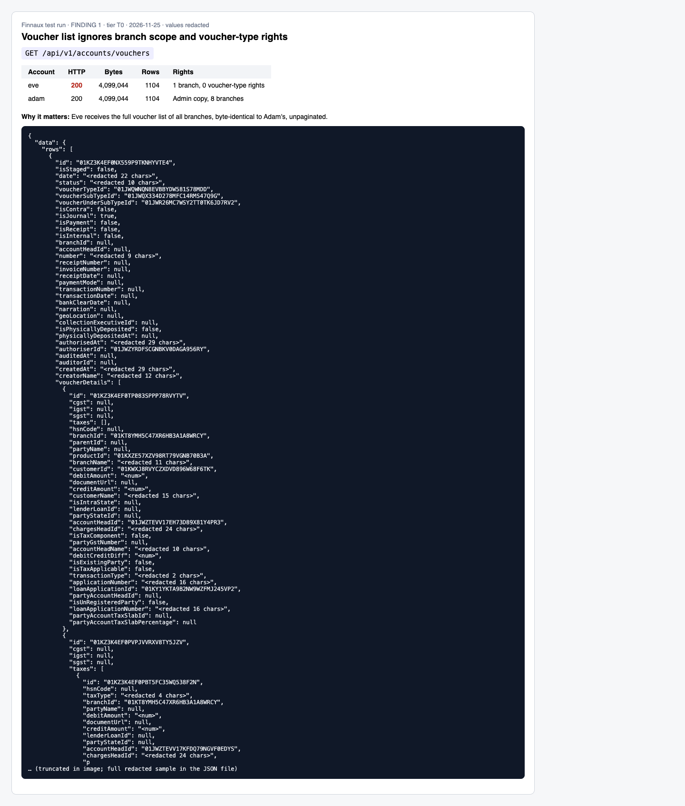
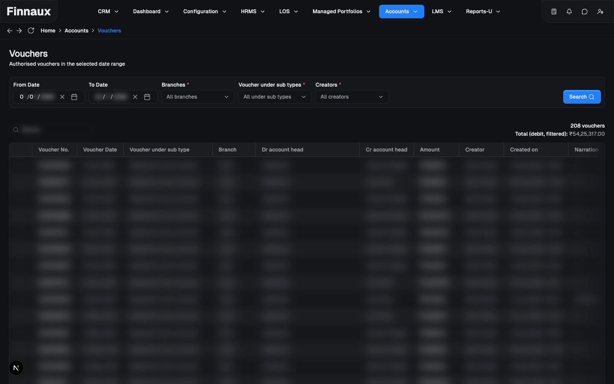

### FINDING 2: Loan applications, DPD summary and financials have no branch scope (high)

```
Where:     GET /los/loan-application (no @RequirePageRight, findAll(query) gets no session)
           GET /los/loan-application/dpd-summary, GET /financials
Tier:      T0
Expected:  A 1-branch, 3-product user sees only her branch/products
Actual:    loan-application 1045 rows, dpd-summary 1045 rows, financials 2120 rows: all identical to Adam
Control:   GET /reports/application-current-status IS scoped (eve 17 rows vs adam 46), so scoping is missing, not broken globally
Severity:  high
```
Responses: [F2](test-evidence/responses/F2-loan-applications-unscoped.json) ·
[F2b](test-evidence/responses/F2b-dpd-summary-unscoped.json) · [F2c](test-evidence/responses/F2c-financials-unscoped.json) ·
[control](test-evidence/responses/F2d-scoped-control.json)

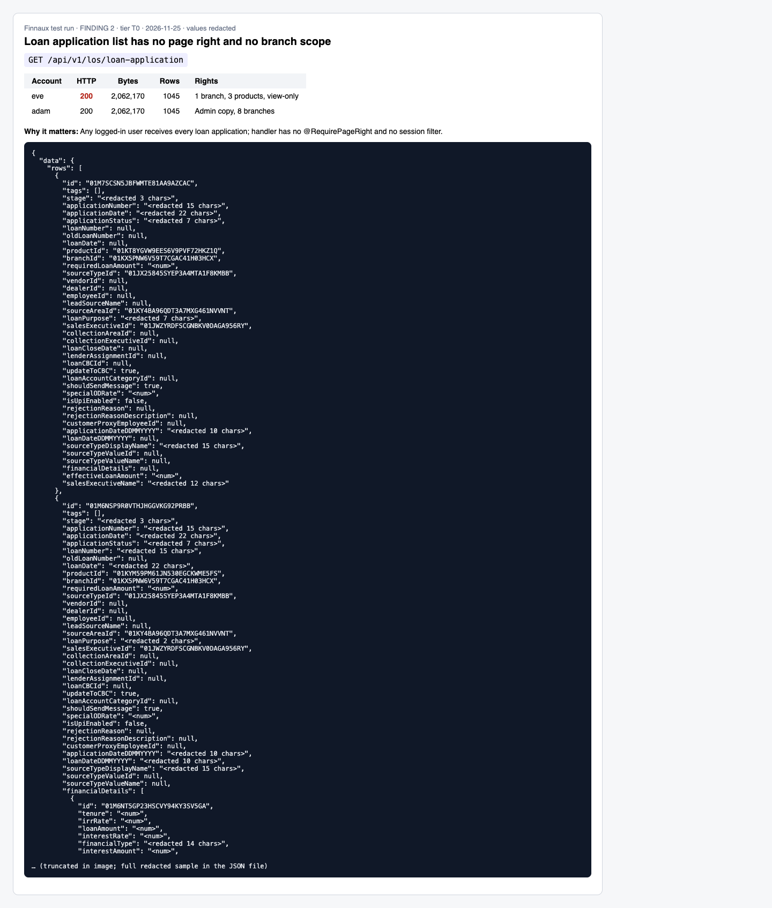
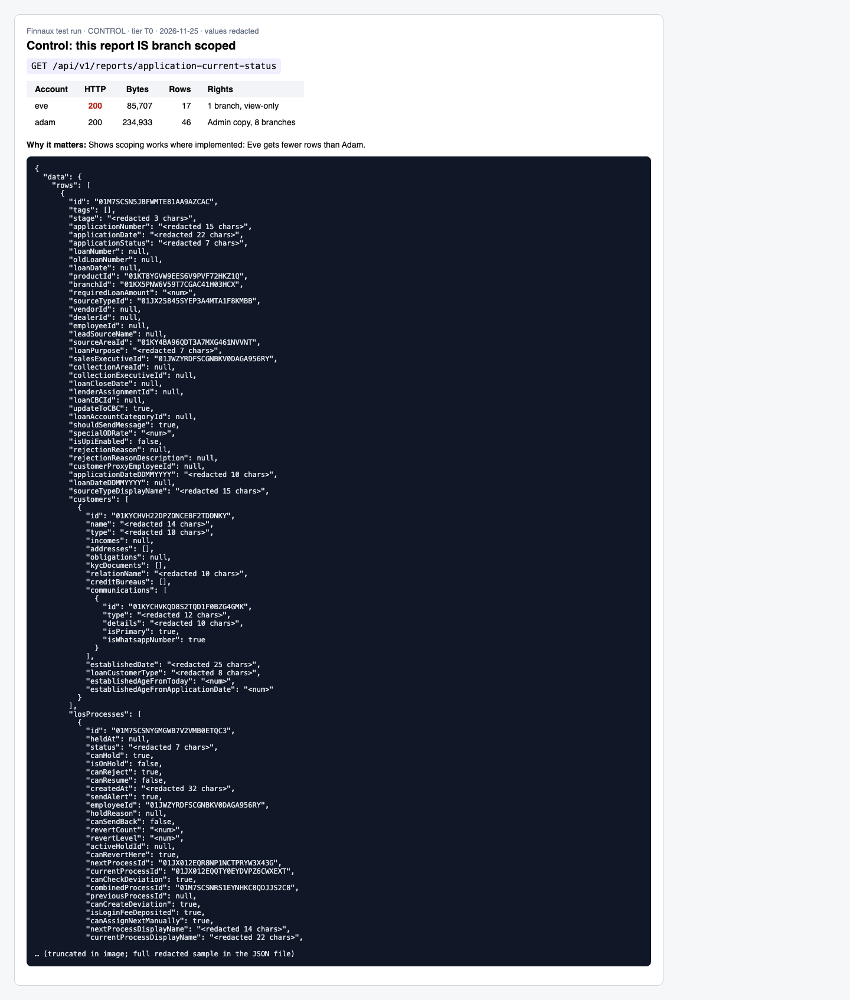

### FINDING 3: External APIs configuration readable via API although the page is denied (medium)

```
Where:     GET /configuration/external-apis (no guard). Also PUT /configuration/external-apis/integration-groups/:id has no guard (static; P2 will probe)
Tier:      T0
Expected:  403 (Eve has no "External APIs" page; UI shows Access Denied)
Actual:    200, 15 integration groups with endpoints, authSecretRef and header templates. No literal secret seen (x-api-key values are templates)
Severity:  medium (read); high if the PUT is confirmed (any user could switch integration providers)
```
Response: [F3](test-evidence/responses/F3-external-apis-readable.json)

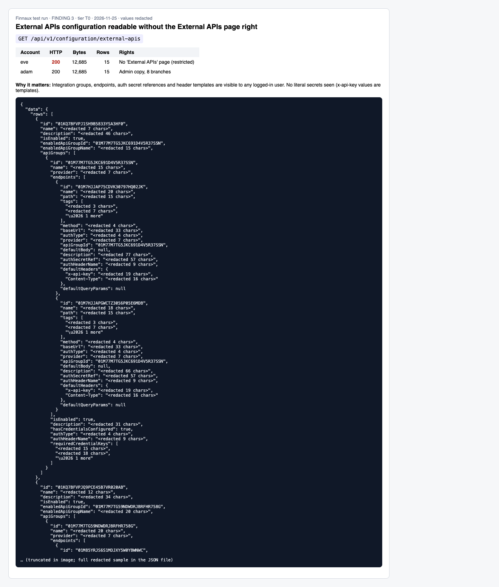
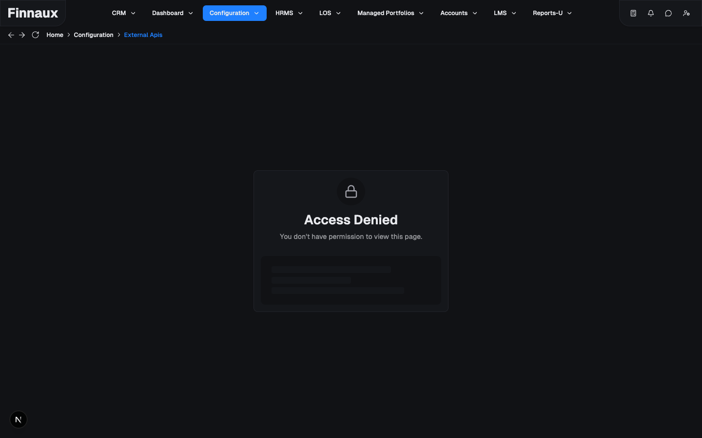

### FINDING 4: SMS configuration readable; its PUT has no guard (medium, PUT pending P2)

```
Where:     GET + PUT /configuration/message-configuration/sms-configuration[/:id] (no guard on either)
Actual:    GET 200, 33 SMS event configs (event, enabled, template). PUT not probed yet
```
Response: [F4](test-evidence/responses/F4-sms-config-readable.json)

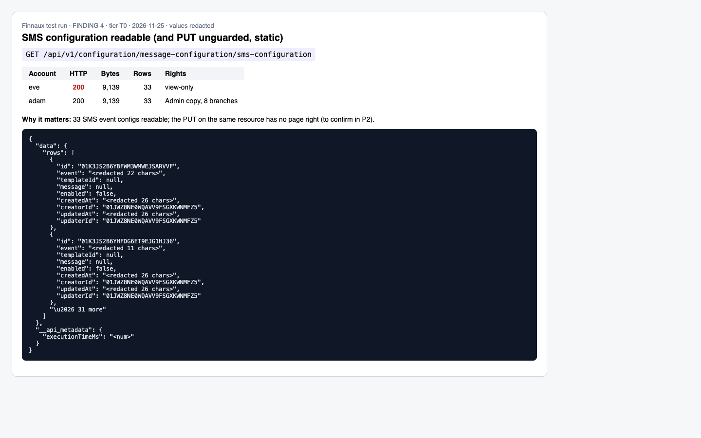

### FINDING 5: Salary data of all employees visible to a branch-level user (high)

```
Where:     GET /hrms/payroll-management/assignments (baseSalary, 30 rows)
           GET /hrms/performance-management/salary-history/employees (baseSalary, 29 rows)
Expected:  Eve has no EMPLOYEE_* pages; salary of other employees should be refused or scoped
Actual:    200 for both, identical to Adam. No page right on either handler
Severity:  high (personal financial data)
```
Responses: [F5](test-evidence/responses/F5-salary-assignments.json) · [F5b](test-evidence/responses/F5b-salary-history.json)

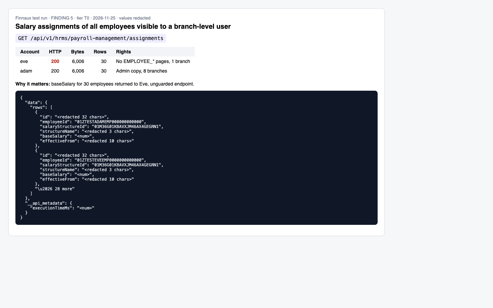

### FINDING 6: Employee filter bypasses the guarded employee list (medium)

```
Where:     GET /hrms/employees is 403 for Eve (guarded by EMPLOYEE_ALL), but GET /hrms/employees/filter returns 29 rows (no guard)
Also:      POST /hrms/employees/off-role has no guard and no body (static; P2 will look at it, not call it blindly)
```
Response: [F6](test-evidence/responses/F6-employees-filter.json)

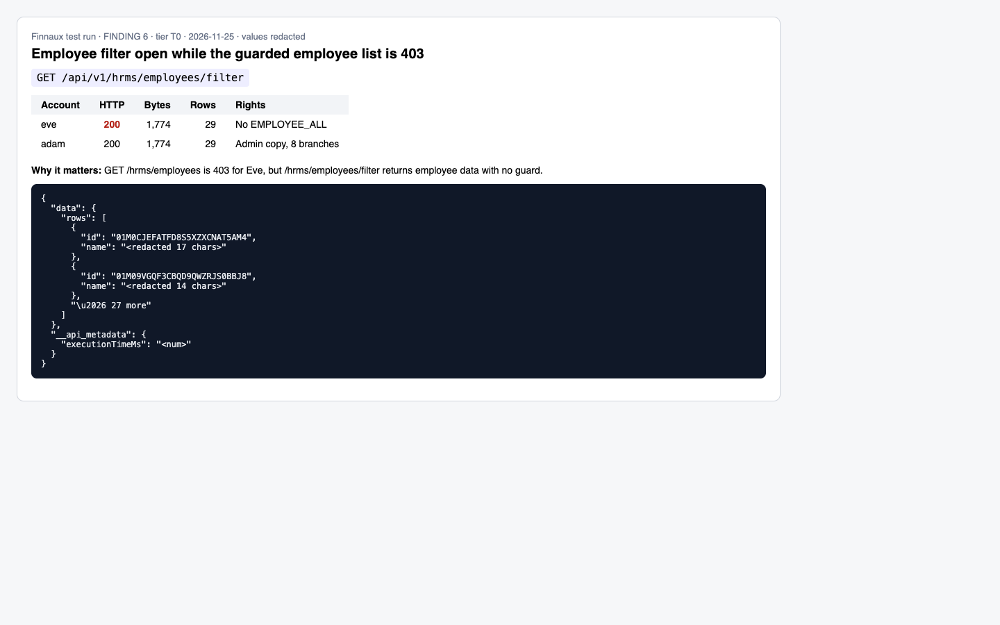

### FINDING 7: 19 GET endpoints answer 500 when query params are missing (low)

```
Examples:  /dropdown/common, /dropdown/enum, /crm/entries, /crm/sub-types, /hrms/leave-management/resignations,
           /lms/customer/review-bank, /rule-engine/rules-by-levels (same for adam)
Expected:  400 validation error
Actual:    500 "Internal server error" (no stack trace leaked: good)
```
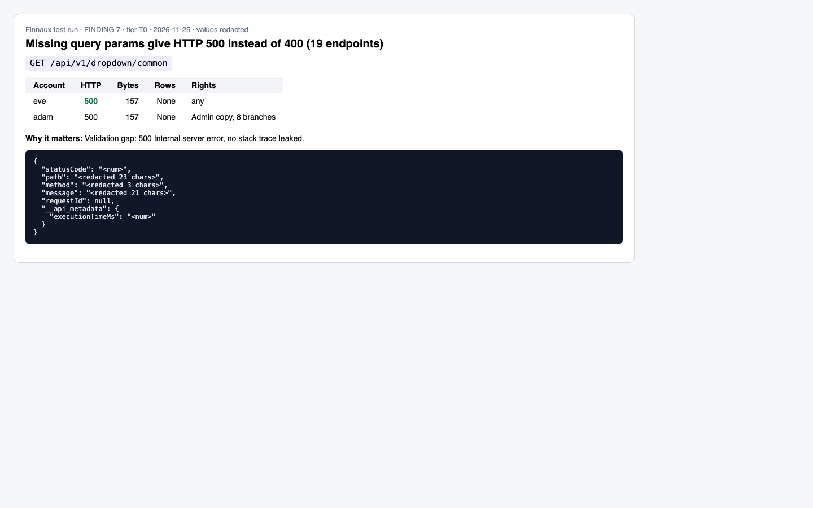

### FINDING 4 update: SMS configuration PUT confirmed unguarded at runtime (P2: 400 = passed guard)

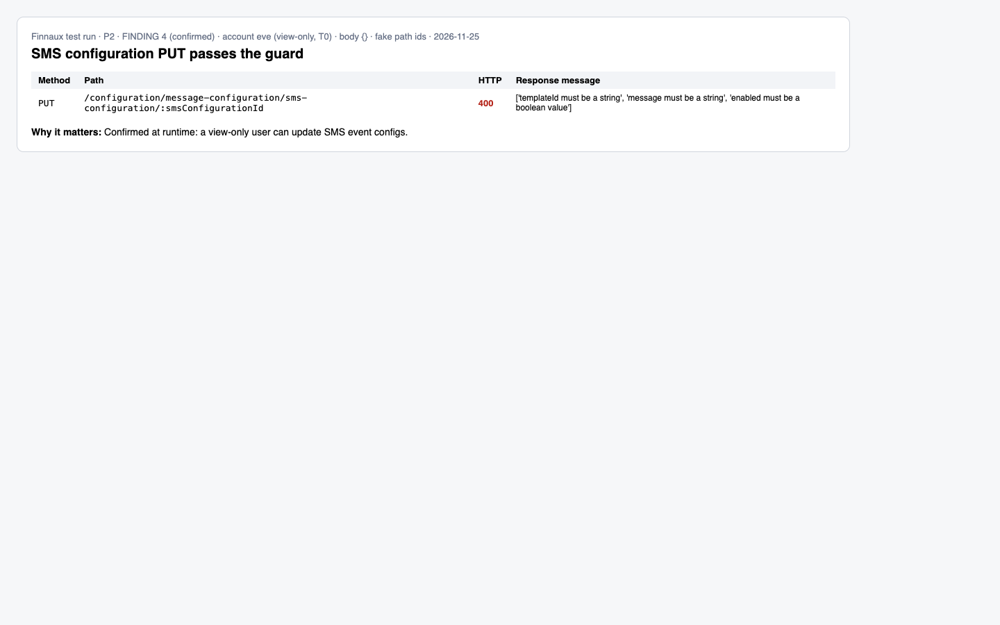

### FINDING 8: Company settings writable by a view-only user (high)

```
Where:     PUT /configuration/company, /company-addresses, /company-financial-details, /company-system-settings
Tier:      T0 (P2)
Expected:  403 (Eve has no edit right; COMPANY_CONFIGURATION is a restricted page)
Actual:    400 on all four: the guard let Eve through; only validation stopped the empty body
Severity:  high (company identity, cash limits, system settings)
```
Response: [P2-F8](test-evidence/responses/P2-F8-company-settings-writable.json)

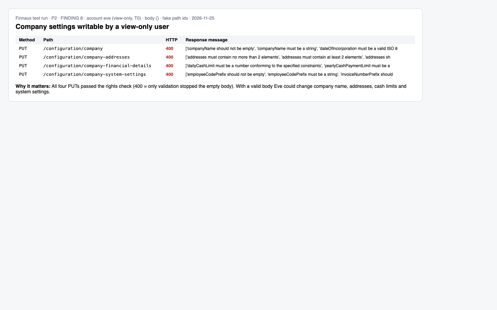

### FINDING 9: DTOs imported with `import type` disable validation; empty body wrote a row (high)

```
Where:     hrms/performance-management/performance-management.controller.ts (32 DTOs), also
           configurations/crm-configuration/crm-configuration.controller.ts (10), crm/crm-tickets/crm-tickets.controller.ts (4)
Cause:     `import type { ...Dto }` erases the class at runtime, so Nest's ValidationPipe has no metatype and skips validation.
           Performance-management also has no @RequirePageRight at all.
Actual:    7 POSTs with {} reached the database (500), PUT pip/:id/status returned 200 for a non-existent id.
           POST /goals enrolled Eve into a real review cycle before failing (no transaction): +1 row, see P2 journal.
Severity:  high (unvalidated writes by any logged-in user, partial writes)
Fix:       Import DTO classes as values (`import { ... }`), add page rights, wrap createGoal in a transaction.
```
Response: [P2-F9](test-evidence/responses/P2-F9-validation-bypass-partial-write.json)

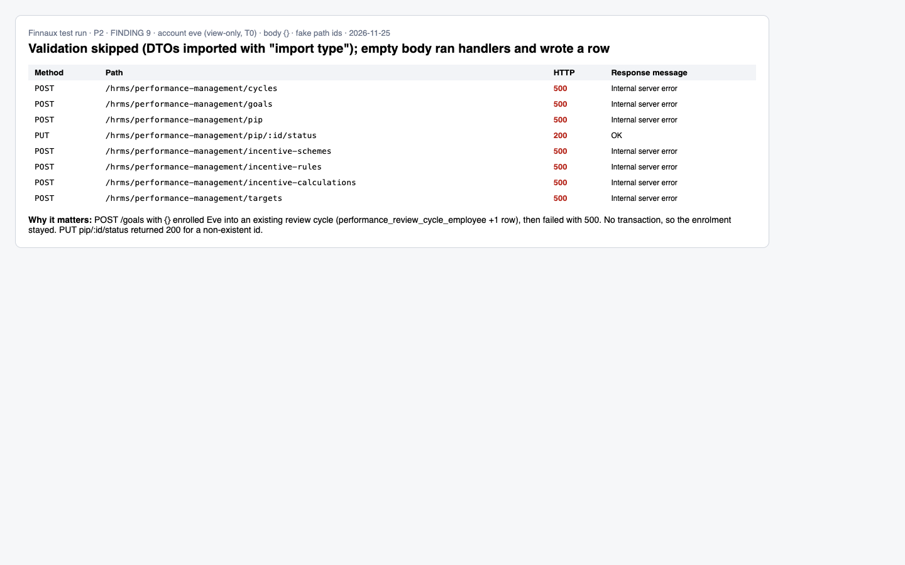

### FINDING 10: Aadhaar OTP and Finnaux KYC calls need only a view right (high)

```
Where:     external/finnaux/finnaux.controller.ts:20 KYC_PAGE_RIGHTS = canView on any of 12 pages (customers, LOS, vendors, ...)
Actual:    Eve (view-only) passed the guard on POST /external/finnaux/aadhaar/generate-otp (400 on missing Aadhaar number)
Impact:    A view-only user can trigger paid KYC calls and send OTPs to real people (throttled at 10/min)
Severity:  high
```
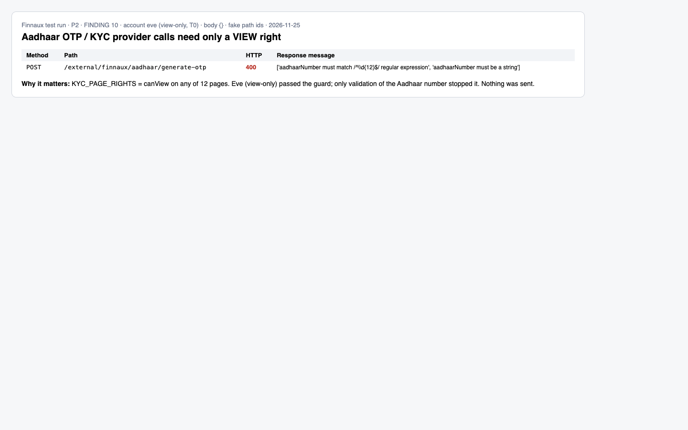

### Control: 106 guarded write endpoints refused Eve with 403

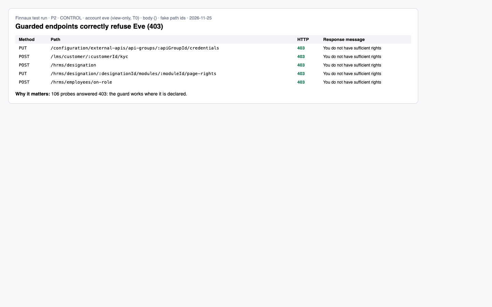

### Notes

- N1: `GET /app-logs` is an SSE stream open to any logged-in user; nothing ever calls `logSubject.next`, so it stays
  open and empty until the client times out. Low.
- N2: `GET /service-accounts` renders an HTML page with service account names, ids, permissions and allowed domains
  to any logged-in user (clientId/clientSecret omitted). Low. 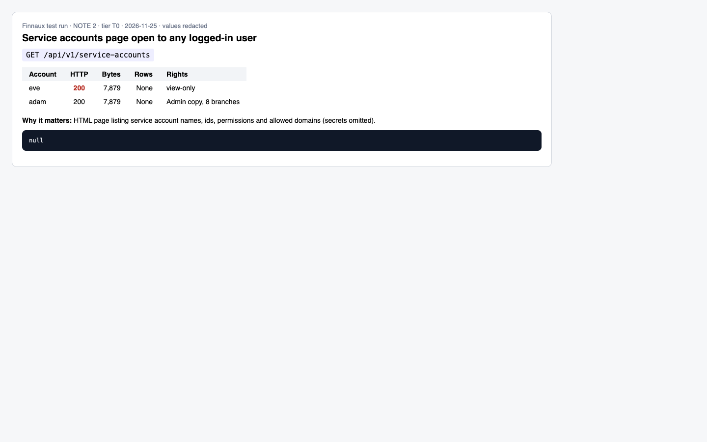
- N3: Login with an unknown username returns 404 (possible username enumeration). To compare with a wrong password
  for an existing user in a later phase (needs care: lockout).
- Eve's only API 403s among 270 GETs: `/audit-logs`, `/configuration/crm-configuration/employee-assignment`,
  `/crm/tickets/dashboard`, `/hrms/designation`, `/hrms/employees`.

### UI screenshots (Eve, T0, data blurred)

| Screen | Image |
|---|---|
| Login (password masked) | 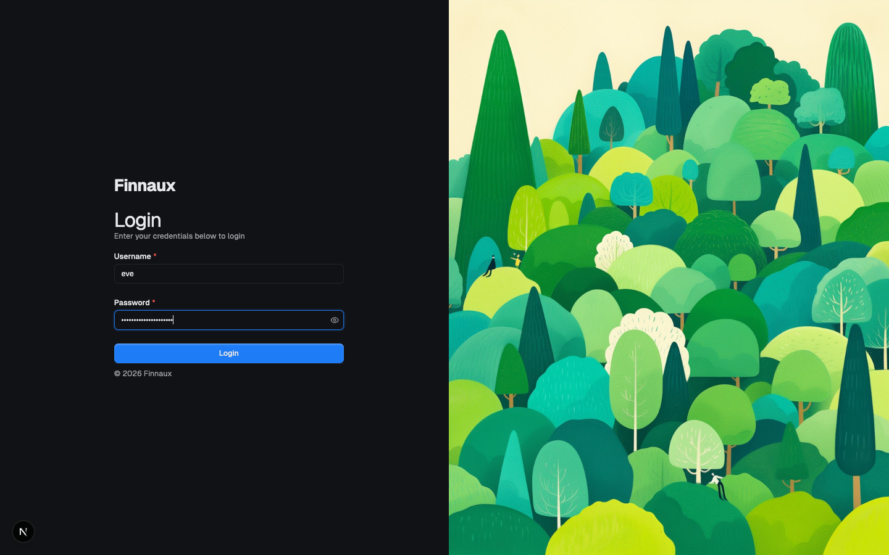 |
| Dashboard and top menu | 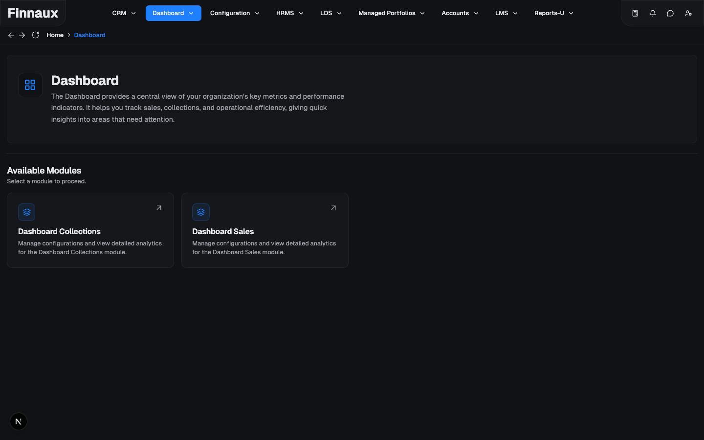 |
| Accounts → Vouchers |  |
| Configuration → External APIs (denied) |  |
| HRMS → Designations (denied) | 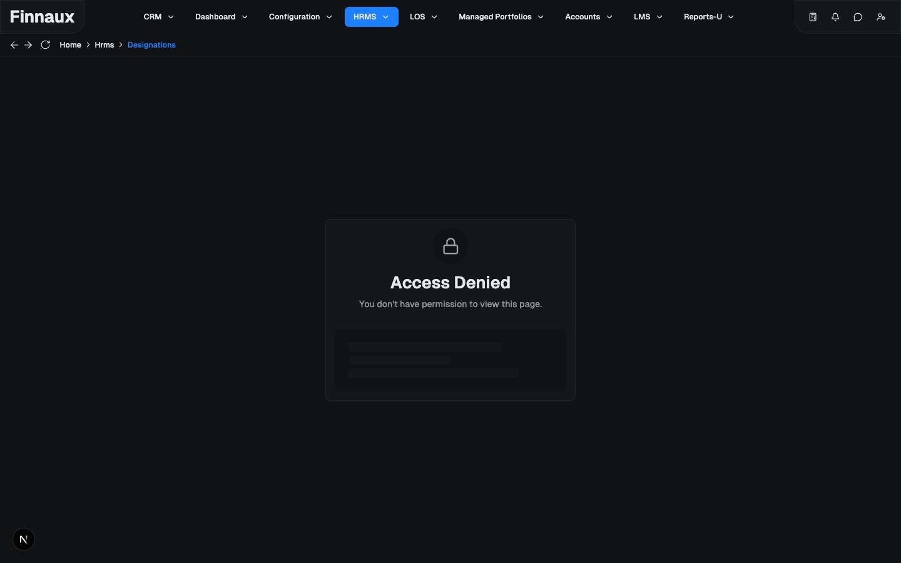 |
| LOS → Application status | 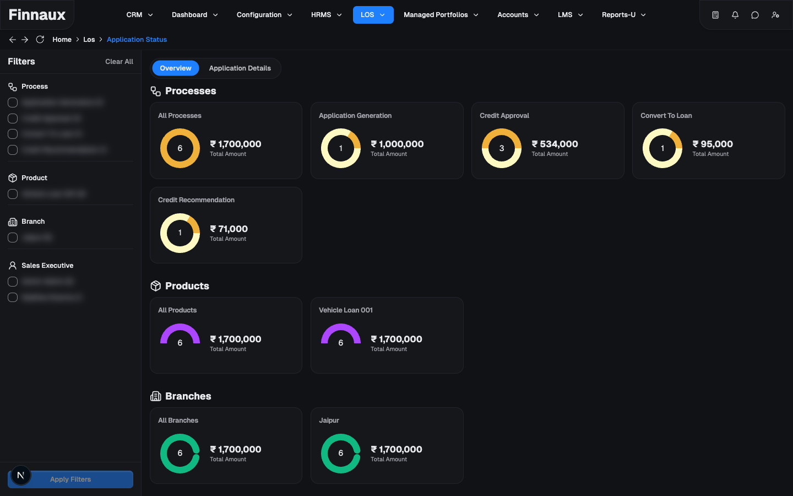 |
